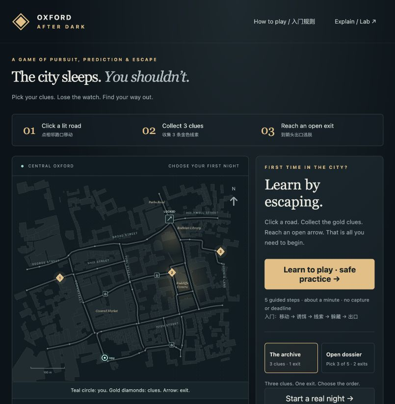

# Oxford After Dark

**Public playable beta · desktop browsers · MIT game code / ODbL map data**

[Play in your browser](https://zyjroger1-hub.github.io/oxford-after-dark/) · [中文入门规则](HOW_TO_PLAY_ZH.md) · [Release review](RELEASE_REVIEW.md)



*A game of pursuit, prediction and escape.*

A complete local browser strategy game on cached Oxford OpenStreetMap streets, now with an interactive first-night tutorial, two missions, optional route guidance, noisy sprints and earned escape badges. Everything runs locally with no paid API, account, cloud service, online tiles or package installation.

## Start without installing packages

From this project folder:

```sh
python3 scripts/serve.py
```

Your browser opens **http://127.0.0.1:4173**. On a Mac, double-click `START_GAME.command` for the same launch. Keep Terminal open; Ctrl+C stops the server. If the port is occupied, use `python3 scripts/serve.py --port 4174`.

Alternative with Node.js 20+: `npm start`. No `npm install` or build is needed. Opening `index.html` directly as a file is unsupported because ES modules and the bundled map use normal HTTP loading. The repository is prepared for static GitHub Pages hosting; Python and Node are only local launch options, not server-side game requirements.

## The beginner rules / 入门规则

1. **Click a lit road.** You move continuously to an adjacent junction. While travelling, queue one next turn.
   **点亮起的相邻路口移动；途中可提前选下一次转弯。**
2. **Collect 3 gold clues.** Arrival collects a clue automatically. You choose the order.
   **抵达金色菱形自动收集，正式局需收齐 3 条。**
3. **Reach an open arrow.** The clues unlock the exit. Stay more than 6 road metres from the watch.
   **到已解锁的箭头出口逃脱，追捕者沿路距离 6 米内可抓住你。**

**Start with “Learn to play · safe practice”.** Five small lessons teach moving, leaving a delayed decoy, collecting a clue, hiding and using an exit. This is a real playable road journey with one clue, a stationary watch, no capture and no deadline. It takes about 65 seconds of continuous play at 1×, plus time spent reading or waiting. Only the next lesson’s action is offered, so you cannot accidentally take a wrong practice turn. You can skip or restart practice at any time.

After finishing, **Play my first real night** starts The Archive / Lantern / seed 3 at 1×. That is the recommended introductory arrangement. A regular night usually takes 3–5 simulated minutes, with an absolute six-minute deadline. Practice intentionally has no deadline.

The **How to play / 入门规则** button opens a concise English/Chinese rules sheet from any screen. It pauses an ongoing night; use Resume when you return.

## Choose your mission

| Mission | Goal | What changes |
|---|---|---|
| **The archive** | Collect the three fixed clues, use one exit | Original focused pursuit game; any clue order |
| **Open dossier** | Collect **any 3 of 5** clues, use **either of 2** exits | Skip dangerous clues, change plans and choose an escape side |

Both missions use the same map and core rules. The five candidate clue locations and both exits are public in Dossier. Your actual selections, collected list and next click stay hidden from the AI. After your third clue, both exits open and remaining clues no longer need to be visited; the game does not require visiting all five.

Three authored start/objective arrangements cycle by seed. Night settings contain difficulty and seed controls, collapsed by default so a first-time player can just begin. Fixed seed and identical timed actions reproduce a run; different human timing can produce a different outcome.

## Three pursuers

| Difficulty | Behaviour | AI sight | Your enemy marker |
|---|---|---:|---|
| **Lantern** | Greedy shortest pursuit, last-sighting check, objective patrol | 62m | Always visible |
| **Shadow** | Candidate-distribution search after losing contact | 78m | Seen within your 110m corridor sight; memory lasts 14s |
| **Midnight** | Observed-heading/public-goal interception and search | 90m | Same sight; memory lasts 9s |

The marker says LAST SEEN when stale. **IT CAN SEE YOU** means the watch has a visual observation. Turning a corner usually breaks contact. Neither Search nor Intercept knows your hidden position or future route. None is a trained model.

## Tools: simple costs, different uses

All tools activate only while stationary at a junction. You can select a turn immediately after activating Decoy or Sprint. Pausing freezes tool timers along with everything else.

| Tool | Key | Uses | Benefit and cost |
|---|---|---:|---|
| **Hide** | H | 2 | At a house marker only; six seconds invisible beyond 10m, but forced stillness; twenty-second cooldown; capture still applies within 6m |
| **Decoy** | D | 2 | Sounds at that junction four seconds later; heard within 260 road metres; leave before it rings |
| **Sprint** | S | 2 | Five seconds at 6.6m/s instead of 4.4m/s; loud footsteps at the launch junction, heard within 200m |

Sprint and Hide cannot overlap. Sprint does not stop close-range capture. A stationary sprint still consumes its five-second timer, so start moving promptly. Hearing a sound without sight can redirect investigation; seeing you overrides sound. The AI receives the **same node-only footstep observation** from a decoy or sprint, without the source type or remaining resources. The replay, which is allowed to reveal world history, labels the actual source.

## Guidance, planning and replay

- A dotted gold route suggests a shortest path to a chosen goal. It **ignores pursuer risk**, does not move you automatically and is never passed to the AI.
- Click a clue/exit chip in the sidebar to preview that destination. The **Route guide** toggle hides the hint for a more demanding run. The normal game still permits every adjacent road.
- Space or Pause stops the whole simulation. Restart resets the current mission, seed, resources and replay. Switching mission/difficulty abandons the current run.
- Speed 1×/2×/4×/8× changes both actors, sensors and timers equally. The tab automatically pauses when hidden; resume after returning.
- After a real escape, badges explain what you achieved: **Ghost** (never seen), **False trail** (a decoy altered judgment), **Close call** (escaped after coming within 25 road metres), **Before midnight** (escaped in ≤5 minutes). No badges are awarded in practice or on a loss.
- End a run and select **See through its eyes**. Scrub the timeline, play at 4×, or click an event. Teal and dashed coral show actual trails; amber circles show the recorded junction distribution; an outlined junction is the recorded target. Explanations are saved when the decision happens, not invented afterwards. Sprint activity and lesson stage are also saved in frames. **Save replay** exports JSON v2 with mission/scenario metadata.

## Shared simulation and rules

Default runner 4.4m/s; pursuer 4.05m/s in all difficulties. These are fictional game speeds. Road length in metres affects movement time; no geographic stretch or synthetic road connection is used. Edge offsets follow retained polylines.

Capture is ≤6m shortest road distance, including head-on encounters mid-edge and approaches from different roads around a junction. Capture precedes clue/exit success in the same step. Internal steps are ≤0.05s; even sprinting, combined movement per step is at most 0.5325m. Sensors sample every 0.5s. An AI road choice changes at a junction, not by teleporting mid-edge.

Visibility approximates a straight road corridor: within the mode’s range, same-edge positions see each other; otherwise road distance must be close to Euclidean distance. Buildings are visual context, not a 3D occlusion model. This is a fictional game, not a claim about real nighttime access, openings or safe routes.

## Code map

| File | Purpose |
|---|---|
| `src/game.js` | Missions, five practice lessons, actions, sprint/noise rules, sensor boundary, outcomes, badges and replay records |
| `src/graph.js` | Metre-weighted road graph, Floyd–Warshall routes, edge positions, road distance and visibility |
| `src/ai.js` | Observation-only belief, Greedy, Search and Intercept; both public exits are hypotheses in Dossier |
| `src/bots.js` | Courier and Cautious runner policies, both using the player-visible enemy view |
| `src/app.js` | SVG UI, goal hints, tutorial coach, controls and historical replay display |
| `scripts/import-map.py` | One-time acquisition/cache and geometry-preserving preprocessing |
| `scripts/experiment.mjs` | Reproducible paired matches for either mission, using the same core |
| `tests/core.test.mjs` | Original invariants plus onboarding, mission choice, sprint, audio privacy and badge tests |

Buildless ES modules and SVG avoid package downloads. Live rendering and headless matches use the same rules; practice is an explicitly separate training configuration.

## Tests and experiments

Requires Node 20+ for command-line checks only:

```sh
npm test
node scripts/verify-release.mjs
node scripts/experiment.mjs --runs=5 --smoke
node scripts/experiment.mjs --runs=5 --smoke --contract=Dossier
npm run experiment
node scripts/experiment.mjs --contract=Dossier
```

**41 tests pass. Final v2 batches contain 1,200 games**: 600 per mission, each with two runner policies × three pursuer configurations × 100 paired seeds. Each mission first ran a 30-game smoke batch. The two established bots do not sprint or hide; their comparison therefore does not assess optimal play with those tools. Practice is excluded.

[Archive results](RESULTS.md), [Dossier results](RESULTS_DOSSIER.md), and `data/results*.json` contain exact configurations, aggregate metrics and all individual outcomes. These are algorithms playing algorithms, not human-experience statistics. Only three authored arrangements recur across seeds; sensing and player marker memory also differ by difficulty. Cautious has a timeout in one recurring Dossier arrangement, which is preserved in the report.

[QA_V2.md](QA_V2.md) records actual new browser operation; [QA.md](QA.md) retains the original v1 verification history. [DESIGN_NOTES.md](DESIGN_NOTES.md) explains tradeoffs. [LEARNING_GUIDE_ZH.md](LEARNING_GUIDE_ZH.md) explains the actual core code in Chinese. Public release notes and known limits are in [RELEASE_NOTES.md](RELEASE_NOTES.md) and [RELEASE_REVIEW.md](RELEASE_REVIEW.md).

## Map provenance and license

**© OpenStreetMap contributors** · map database under [ODbL 1.0](https://opendatacommons.org/licenses/odbl/1-0/). The attribution and license link stay visible below the map. Derived road and building data is distributed under the same ODbL license; see `data/LICENSE.md` and bundled `data/ODbL-1.0.html`.

Source: official [OSM bbox API](https://www.openstreetmap.org/api/0.6/map?bbox=-1.2615,51.7504,-1.2518,51.7568), obtained **26 October 2026 at 16:51:19 UTC**. Exact provenance is in `data/provenance.json`; untouched source is distributed losslessly as `data/oxford.osm.xml.gz` (expanded to `data/oxford.osm.xml` by the importer), with SHA-256 and processing metadata in `data/map.json`. An initial Overpass capacity error was followed by successful official OSM acquisition. No map data was downloaded again for v2.

Processing: local equirectangular metre projection; curated named streets around Radcliffe Camera; exclude area polygons, footway branches and non-foot-accessible restricted roads; clip; keep largest component; contract degree-two chains with full geometry; split long chains at existing source points after roughly 80m. Result: **52 junctions, 59 bidirectional roads, 620 background building footprints**. Two detached source fragments were excluded. Shelters, objectives, access and sight rules are game definitions.

`python3 scripts/import-map.py` expands the bundled gzip when needed and rebuilds from that cached XML; it downloads only if both cache forms are absent. A changed source/filter can require remapping authored node IDs. Normal play requests only localhost files and works without internet access.

## Short English project introduction

> Oxford After Dark is a local pursuit game on cached Oxford street geometry. A guided first night teaches the rules through play; two missions offer fixed objectives or a choice of clues and exits. Evade observation-limited pursuers using corners, shelters, delayed decoys and noisy sprints, then inspect their recorded beliefs and decisions in a scrub-able replay.

Original code/documentation: MIT (`LICENSE`). OSM-derived data: ODbL 1.0. No external art or font packages, telemetry, paid API or cloud game backend.

This project was developed with AI assistance. Runtime pursuers are explicit graph algorithms, not LLM calls. See [CONTRIBUTING.md](CONTRIBUTING.md) for the observation boundary and checks.
